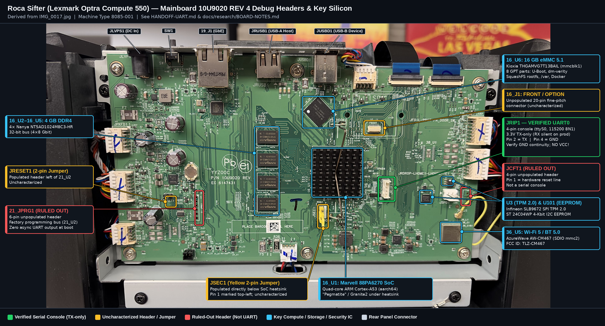
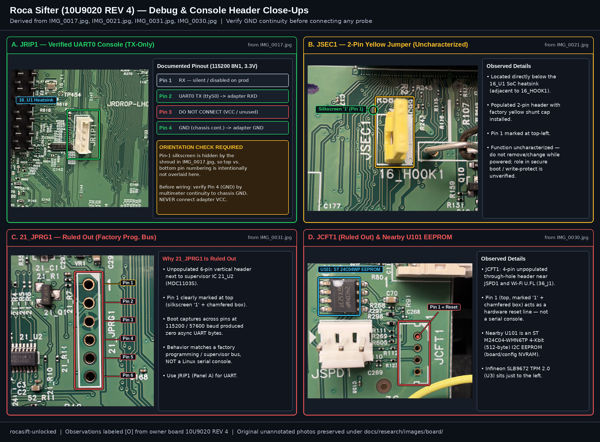

# UART Console Reference (`JRIP1` on `10U9020 REV 4`)

Consolidated 2026-10-30. Full boot-line analysis: [docs/research/diagnostic-research-2026-10-30.md](docs/research/diagnostic-research-2026-10-30.md).

## Verified Console Header: `JRIP1`
- **Location:** 4-pin vertical connector immediately to the right of the main SoC heatsink (`16_U1`) on mainboard `10U9020 REV 4` (`IMG_0017.jpg`).
- **Pinout:**
  - **Pin 2:** UART0 TX (`ttyS0` at `0xd4030000`, **115200 8N1**, 3.3V logic). Outputs Boot ROM (`Si Gr2-RevC1 3.3.22-6h`), U-Boot 2022.01 (`pegmatite-u-boot`), Linux kernel, systemd unit startup, and runtime `MDCIF` sensor/cover events.
  - **Pin 4:** Ground (continuity-verified to chassis ground).
  - **Pin 1 / RX:** Silent; serial input is disabled on production hardware and no `getty` login prompt runs on `ttyS0`.
- **Connection:** Connect USB-TTL adapter `GND` → `JRIP1` pin 4 and adapter `RXD` → `JRIP1` pin 2 (`115200 8N1`). Do **not** connect `VCC`.
- **Capture helper:** `tools/serial-capture.sh` (read-only capture pipeline).

## Ruled-Out Headers
- **`21_JPRG1` (6-pin unpopulated header near `21_U2`):** Factory programming bus (position 2 = GND; positions 3 and 6 idle at ~3.6 V; zero async UART bytes during boot).
- **`JCFT1` (4-pin unpopulated header near `JSPD1`):** Pin 1 is a hardware reset line, not a serial console.

## Annotated Board & Pinout Diagrams

