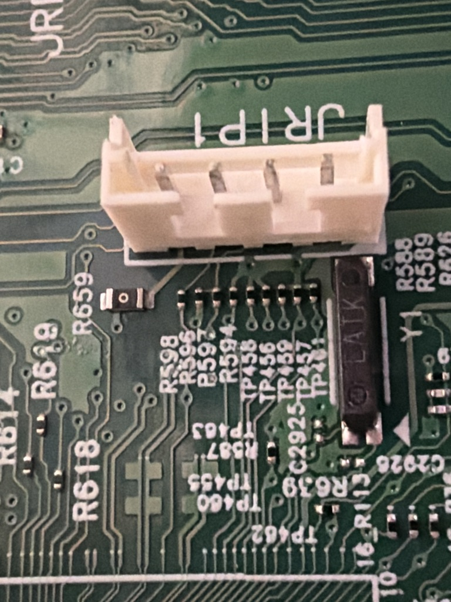
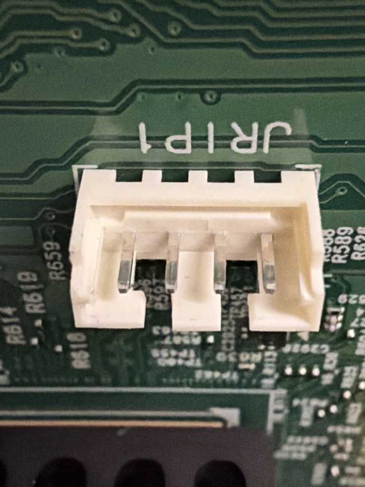
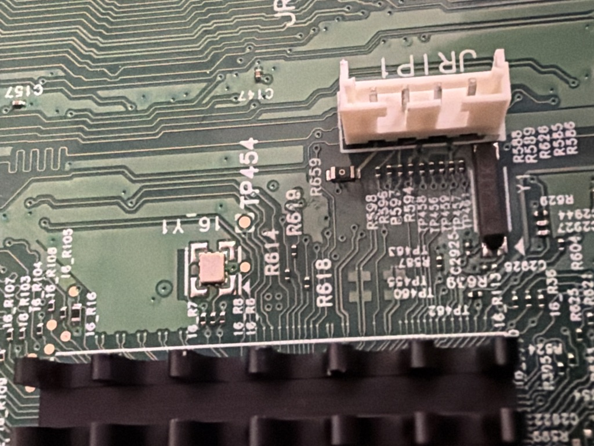

# UART Console Reference (`JRIP1` on `10U9020 REV 4`)

Consolidated 2026-10-30. Full boot-line analysis: [docs/research/diagnostic-research-2026-10-30.md](docs/research/diagnostic-research-2026-10-30.md).

## Verified Console Header: `JRIP1`
- **Location:** 4-pin vertical connector immediately to the right of the main SoC heatsink (`16_U1`) on mainboard `10U9020 REV 4` (`IMG_0017.jpg`, [jrip1-macro-front.jpg](docs/research/images/board/jrip1-macro-front.jpg), [jrip1-macro-pins.jpg](docs/research/images/board/jrip1-macro-pins.jpg), [jrip1-macro-context.jpg](docs/research/images/board/jrip1-macro-context.jpg)).
- **Connector & Pin Geometry** *(updated 2026-11-23 from macro photos `[O]` + datasheet match `[I]`)*:
  - **Style:** **JST PH 4-pin, 2.00 mm pitch** vertical shrouded header (`B4B-PH-K-S` / TE HPI-2 `440054-4` compatible) — mates with a **4-pin JST PH female plug (`PHR-4`)** using `SPH-002T-P0.5S` crimp contacts (or any pre-wired "JST PH 2.0mm 4-pin pigtail").
  - **Dimensions:** `2.00 mm` pin pitch, `0.50 mm × 0.50 mm` square tin-plated posts, **`~3.4 mm`** exposed mating pin depth recessed inside a **`~6.0 mm`** shroud (`~4.5 mm` pocket depth; `8.0 mm` mated height).
  - **Keying:** The `PHR-4` plug's two front locking ribs face the `R598`/`Y1` (SoC) side (two hooked slots flanking a center divider tab); the flat back faces the `JRIP1` silkscreen wall.
  - **Orientation safety:** Macro inspection confirms there is **no silkscreen `1` marker** on `JRIP1`'s outline `[O]`. Always verify Pin 4 (`GND`) by continuity to chassis ground before connecting.
- **Pinout:**
  - **Pin 2:** UART0 TX (`ttyS0` at `0xd4030000`, **115200 8N1**, 3.3V logic). Outputs Boot ROM (`Si Gr2-RevC1 3.3.22-6h`), U-Boot 2022.01 (`pegmatite-u-boot`), Linux kernel, systemd unit startup, and runtime `MDCIF` sensor/cover events.
  - **Pin 4:** Ground (continuity-verified to chassis ground).
  - **Pin 1 / RX:** Silent; serial input is disabled on production hardware and no `getty` login prompt runs on `ttyS0`.
- **Connection:** Connect USB-TTL adapter `GND` → `JRIP1` pin 4 and adapter `RXD` → `JRIP1` pin 2 (`115200 8N1`). Do **not** connect `VCC`.
- **Capture helper:** `tools/serial-capture.sh` (read-only capture pipeline).
- **Adjacent RX/TX Circuitry & RX-Silence Hypothesis** *(2026-11-23 macro inspection)*:
  - `[O]` **`R659`** (top-left of `JRIP1` in `IMG_0017.jpg`, left of `JRIP1` in [jrip1-macro-front.jpg](docs/research/images/board/jrip1-macro-front.jpg)) is a **populated `0 Ω` jumper resistor** whose trace connects directly to the outer pin of `JRIP1`.
  - `[O]` Directly inline between `JRIP1` and the `16_U1` SoC area sits a row of **9 populated 0201 SMD resistors/passives** (`R598`, `R596`, `R597`, `R594`, plus five adjacent components feeding test-point vias `TP458`, `TP456`, `TP459`, `TP457`, `TP461`).
  - `[I]` Unlike the "removed `0 Ω` series resistor" hypothesis raised in NCC Group's earlier Lexmark MC3224i study, the immediately visible series resistors next to `JRIP1` appear populated on this board. UART RX silence is therefore more likely gated in SoC OTP/e-fuses, bootloader/DTB configuration, or an unpopulated/open link further along the path; continuity-tracing `JRIP1` pins through `R659`, `R598`–`R594`, and `TP458`–`TP461` would settle whether a physical break exists.

## Ruled-Out Headers
- **`21_JPRG1` (6-pin unpopulated header near `21_U2`):** Factory programming bus (position 2 = GND; positions 3 and 6 idle at ~3.6 V; zero async UART bytes during boot).
- **`JCFT1` (4-pin unpopulated header near `JSPD1`):** Pin 1 is a hardware reset line, not a serial console.

## Annotated Board & Pinout Diagrams

### `JRIP1` Macro Photos (2026-11-23)

| Front / Inline Passives | Shroud & Pins | SoC Trace Context |
| --- | --- | --- |
|  |  |  |

