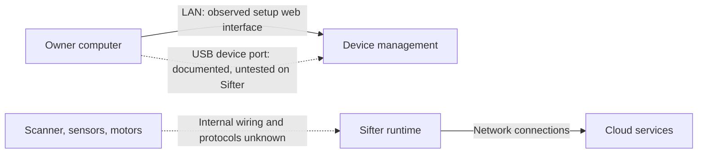

# Roca Sifter — Ports, Connectivity, and Board Research

Reviewed October 24, 2026. [O] = observed on the owner's device; [D] = documented for the Optra platform; [I] = inference or proposed test. Original local notes are preserved separately.

## What we know about this unit

[O] The setup interface identifies the Compute 550 platform and reports firmware `3.5.4`, build target `granite2v8-sifter`. Wi-Fi and Ethernet configuration pages are present. During the latest inspection, Wi-Fi was connected and Ethernet was disconnected. The proxy address and port were empty.

[I] This supports a Compute 550 relationship, but does not establish that every connector, PCB revision, or internal cable matches a retail Compute 550. We have not completed a physical board survey.

## External connectors: documented reference

The retained Compute guide, pages 5–6, numbers the following parts. Compare these labels with photographs of the actual unit before attaching cables.

| Diagram number | Documented part | Role and research value |
| --- | --- | --- |
| 1 | Power button | Controls power; not a communications interface. |
| 2 | Setup button | Enrollment/reset functions depend on model and firmware. Avoid using it as an exploratory diagnostic control. |
| 3 | Headphones jack | Audio output. The previous notes incorrectly called this a ground stud. |
| 4 | USB host port | Accepts supported peripherals such as storage or a MarkNet network adapter. It does not imply that a laptop can access device storage. |
| 5 | Ethernet | Connects the device to a LAN. Useful for separating Wi-Fi problems from job/service failures. |
| 6 | USB device port | Connects to a computer for the embedded setup web server. Both USB ports were observed on the Sifter's rear panel (2026-10-27); which connector is host vs device is not yet confirmed by plugging in. |
| 7 | Ethernet LEDs | Left indicates link, right indicates activity. Activity alone does not establish successful cloud processing. |
| 8 | Power socket | Power input, not a data interface. Verify actual power hardware on the Sifter. |

[D] The older Compute guide gives `169.254.76.86` as the browser address over USB and recommends Windows 10. This is a candidate test address, not an address observed on our Sifter. macOS compatibility and USB networking driver/class remain untested.

Do not select a USB-B or USB-C cable merely from earlier prose. Identify the physical connector first. Documentation for other Optra models includes different connectors and must not be applied to the Compute 550 without checking the model heading.

## Three different kinds of access



- **Management access:** network settings, proxy configuration, passwords, and encrypted log downloads. The local web interface already provides this.
- **Job/data access:** starting jobs, fetching images, identification results, and bin assignments. Our working export observations concern the authenticated cloud account.
- **Hardware access:** the interfaces between compute, scanner, motors, and sensors. We have not identified their buses or commands.

[I] USB may provide another path to the management interface. It does not, by itself, demonstrate a scanner interface, shell, serial console, mass-storage export, or independent job control.

## Board survey (October 27, 2026) — first internal photos

[O] The owner opened the enclosure and photographed the mainboard. Board
identity silkscreen: **Lexmark P/N 10U9020 REV 4, EC 6147431, YYZ00C**.
Annotated photos: [images/board/](images/board/) (IMG_0017 full board;
IMG_0021–0030 close-ups). Photos with the unit serial label visible are kept
local and not published.

Key observations:

- **`21_JPRG1`** [O]: an unpopulated 6-pin header, pin 1 marked with "1"
  (IMG_0027; close-up IMG_0031). Single vertical row, pin 1 = top hole
  (silkscreen "1" + chamfered outline corner). All six nets route as fine
  (~5 mil) signal traces into a common fan-out heading toward the SoC area —
  consistent with a JTAG/programming bus (TCK/TMS/TDI/TDO/reset class).
  No series components inline near the header. No TX/RX/GND legend is
  silkscreened, so the pinout is untraced. Primary UART/JTAG candidate.
  No public documentation exists for P/N 10U9020 or JPRG1 (searched
  2026-10-27) — pinout must be derived from the board.
- **JPRG1 pinout progress (2026-10-27)** [O]: owner multimeter continuity
  against chassis ground identified **pin 3 (third from pin 1 / the triangle
  marker) as ground**. Remaining pins uncharacterized; oscilloscope boot
  probing pending.
- A second unpopulated single-row pad strip sits near the **JRESET**
  silkscreen (IMG_0017) — secondary candidate.
- **`JCFT1`** [O]: unpopulated 4-hole pad row near `JSPD1` and the RF area
  (IMG_0028/0030).
- Test points TP19, TP20, TP45A, 52_TP1 [O].
- **Infineon SLB9672 TPM 2.0** [O] (IMG_0022): a discrete TPM is present,
  consistent with a signed/verified boot chain. Owners should expect secure
  boot on this platform.
- Main SoC sits under a black finned heatsink; markings not yet read [O].
- Four Nuvoton-marked flash/memory packages left of center [O].
- Coin cell (RTC backup) confirmed on board [O].
- Wi-Fi module: shielded can with U.FL antenna pigtail; FCC ID not yet read
  (needs a close-up) [O].
- A Freescale/NXP Kinetis-class MCU (45° rotated, near `HOOK7`) is likely the
  engine/panel controller, separate from the main SoC [I].
- Populated connectors: JLVPS3 (power in), JRUSB1/JUSBD1 (USB), JSPD1, JFAN1,
  16_J1 (FRONT/OPTION panel header), SW1 [O].

[I] The presence of an unpopulated programming header and labeled test points
suggests factory debug access was part of the Lexmark design. Identifying the
JPRG1 pinout (trace-following or continuity testing with power off) is the
next hardware step toward a serial console.

## USB device port: observed behavior (October 27, 2026)

[O] Plugged into a computer, the rear USB-B port enumerates as a Lexmark
composite USB device (VID `043D`, PID `0122`, USB 2.0 High-Speed) with three
interfaces: HID, a vendor-specific interface whose string is **"Scan"**
(bulk OUT `0x02` / IN `0x82`), and a bidirectional USB printer class
interface ("Print"). No CDC network gadget appears: the documented
"EWS over USB at 169.254.76.86" behavior is absent on firmware 3.5.4.

[O] Extensive passive captures on Linux (usbmon + interface claims, idle and
during a live sift job) recorded **zero device-originated USB traffic** — the
port is inert during normal cloud-driven operation. Raw `/dev/usb/lp0` writes
are accepted. Probe tooling and methodology: see the repository's USB probe
runbook (`docs/usb-probe-runbook.md` in the working copy).

[I] Getting data over USB will require actively driving the vendor protocol
on the "Scan" interface's bulk OUT endpoint; passive listening is exhausted.

## Network surface (October 27, 2026)

[O] Port scan of the unit found only 80/443 open — no PJL (9100), IPP (631),
LPD (515), SSH, or telnet. Unknown HTTP paths return the SPA catch-all
(index.html), so no print-heritage CGI endpoints were found. The network
attack surface is the authenticated `/webservices/*` API only.

## Next experiment: identify USB behavior

1. Finish the current job before changing cabling. Photograph accessible connectors and labels, keeping serial numbers private.
2. Identify the device-role port. Use a matching data-capable cable; do not connect two USB host ports with an ordinary A-to-A cable.
3. On the Mac, record USB and network interfaces before connection:

   ```sh
   system_profiler SPUSBDataType
   networksetup -listallhardwareports
   ifconfig -a
   ```

4. Attach only the documented device port and repeat those read-only commands. Compare newly appearing device names, vendor/product IDs, interface classes, and network interfaces. Redact serial numbers and MAC addresses before sharing output.
5. If a new network interface appears, inspect its address and route. Try the documented `169.254.76.86` setup address without changing the Mac's default route or existing device settings. If it does not work, record the result rather than forcing network changes.
6. Compare the resulting web interface with the LAN interface. Log any difference in visible features. Do not assume access to additional services.

Success means a reproducible connection method and identified USB function. No enumeration could instead mean the wrong port, a charge-only cable, missing driver support, or different OEM firmware; it does not prove the port is disabled.

## Internal research, after external identification

The valuable question for platform independence is how the compute unit exchanges images and commands with the scanner and motion hardware. A cable map would help establish whether those components are standard peripherals or need custom drivers.

Start with photos of accessible labels and cable routing. Record board revision and component markings only when safely accessible. Opening the electronics/power enclosure is a separate servicing step; the old notes are not verified disassembly instructions.

UART, JTAG, storage type/package, exact SoC, and internal USB links remain unverified. Do not infer a UART voltage, baud rate, or pin order from another Lexmark product. A headphone jack is not evidence of a serial console. Absence of debug connectors in a consumer diagram does not prove none exist internally.

A wireless-module FCC ID may lead to regulatory documentation, but it may describe only the radio module, and internal photos may be unavailable or confidential. Record the exact label before searching.

## Corrections to earlier notes

- Removed the ground-stud identification and the claim that the USB device port is the narrow slot.
- Removed the assumption that Wi-Fi must be built into the main board: standard Compute documentation describes a USB MarkNet adapter; the Sifter implementation is unverified.
- Removed guaranteed UART/eMMC access and unsupported pinout claims.
- Do not reuse generic Optra setup-button timing for the Roca enclosure. Consult the Roca-specific guide; the older and newer Optra manuals differ.
- The card-handling hardware matters: understanding its connection to compute is essential for independent scanning and sorting.

## Sources and evidence

- Retained local `reference/optra-compute-ug.pdf`, pages 5–6 and 8–11: connector diagram, USB setup address, and network requirements. Not redistributed.
- [Lexmark Optra guide, August 2026](https://support.lexmark.com/content/dam/support/collateral/lexmark_solutions/optra/ug/Optra-User-s-Guide_en.pdf), Compute 500/550 section, pages 8–9: corroborates connector roles. Other model sections are not interchangeable.
- [Roca buttons, lights, and sounds](https://support.rocarobotics.com/hc/en-us/articles/47929740990733-Roca-Sifter-Buttons-Lights-and-Sounds): use for the Sifter's external controls.
- [Device observations](../device-findings.md) and [log envelope findings](../log-format.md): local management access does not currently provide plaintext support logs.
