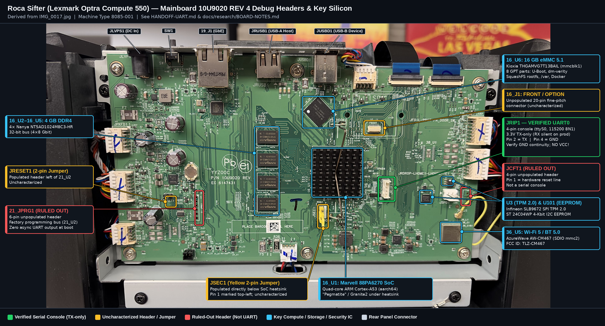
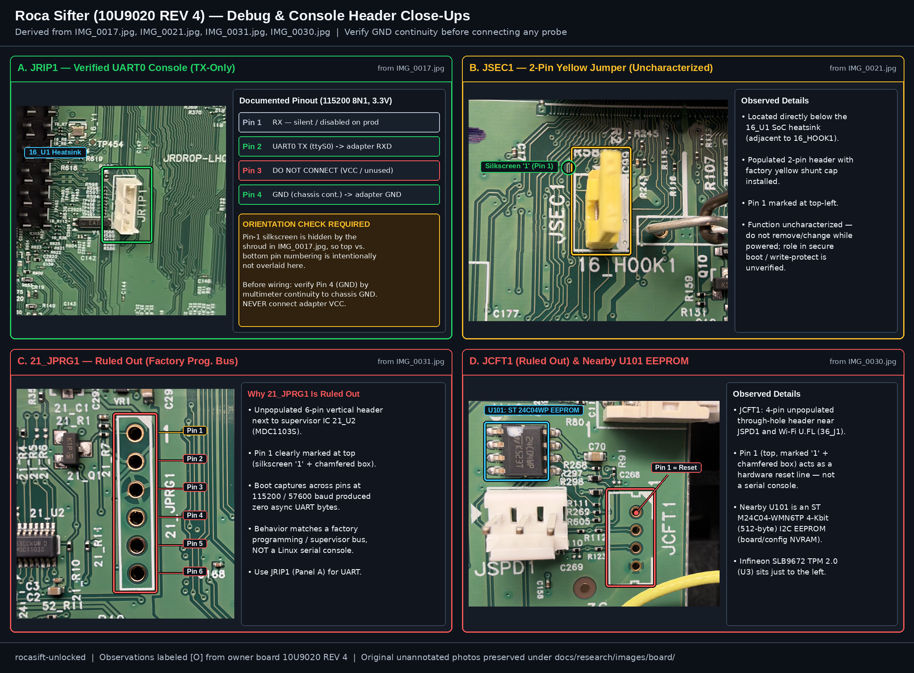

# Roca Sifter — Ports, Connectivity, and Board Hardware Survey

Reviewed November 1, 2026. `[O]` = observed on the owner's device (photos in [images/board/](images/board/), UART boot log, or EWS settings dump); `[D]` = documented for the Optra platform; `[I]` = inference.

## 1. Platform & Board Identity

- **Platform:** OEM variant of the **Lexmark Optra Compute 550** (`granite2v8-sifter`, firmware `3.5.4`) `[O]`.
- **Unit Label:** Machine type **`8085-001`**, assembly P/N **`10U0900-003`** `[O]` (retail Optra Compute 500/550 manuals cover machine type `8080`).
- **Mainboard PCB:** **Lexmark P/N `10U9020 REV 4`, EC `6147431`, `YYZ00C`** ([IMG_0017.jpg](images/board/IMG_0017.jpg), [IMG_0027.jpg](images/board/IMG_0027.jpg)) `[O]`.
- **Wireless Modular Approval:** `"Contains FCC ID: TLZ-CM467"` / `"Contains IC: 6100A-CM467"` (AzureWave `AW-CM467` 802.11ac + BT 5.0 module) `[O]`.

## 2. Rear Panel Connectors ([IMG_0014.jpg](images/board/IMG_0014.jpg), [IMG_0015.jpg](images/board/IMG_0015.jpg), [IMG_0028.jpg](images/board/IMG_0028.jpg))

From left to right across the rear panel bracket:

| Silkscreen | Connector | Observed Role |
| --- | --- | --- |
| `JLVPS1` | Barrel jack | DC power input `[O]` |
| `SW1` | Pushbutton | Rear tactile switch `[O]` |
| `19_J1` | RJ-45 (`PRA1T844-6/6`) | Gigabit Ethernet with link (left) and activity (right) LEDs `[O]` |
| `JRUSB1` | USB Type-A (Host) | USB 2.0 host port for flash storage or peripherals `[O]` |
| `JUSBD1` | USB Type-B (Device) | Enumerates on a host computer as `043d:0122` ("Lexmark xxxx", USB 2.0 High-Speed composite device) `[O]` |

## 3. Mainboard Chip Inventory (`P/N 10U9020 REV 4`)

### Core Compute, Memory & Storage (Sheet 16)

| Silkscreen | Package & Exact Marking | Component Identity | Role | Photo Reference |
| --- | --- | --- | --- | --- |
| **`16_U1`** | BGA under black finned heatsink (clipped to `16_HOOK1` / `16_HOOK2`) | **Marvell 88PA6270 ("Pegmatite" / Granite2) Quad-Core ARMv8-A SoC** | 4× ARM Cortex-A53 cores (`0x410fd032`, 64-bit `aarch64`), integrated Marvell WTM security co-processor, `mv61x0-vdma` virtual DMA, dual CIS scanner interface, motor PWM controllers, SDHCI (`mmc0`–`mmc2`), dual EHCI USB 2.0 hosts, USB device controller (`d4224000.usb3dev`), and Synopsys `DWMAC1000` Ethernet MAC `[O]`. | [IMG_0017.jpg](images/board/IMG_0017.jpg), [IMG_0021.jpg](images/board/IMG_0021.jpg) |
| **`16_U2` `16_U3` `16_U4` `16_U5`** | 4× 78-ball FBGA `NANYA 2534` `NT5AD1024M8C3-HR` `449355R1EV L TW` | **4× Nanya 8 Gbit (1 GB) DDR4-2666 SDRAM** (`1024M × 8-bit`) | **4 GB System RAM.** Four 8-bit wide chips in a vertical column left of the SoC form a 32-bit (`4x8`) DDR4 bus initialized at `DDR4 800MHz 4x8 8Gbit (10U9010)` (`3847976K/4194304K` available in Linux) `[O]`. | [IMG_0017.jpg](images/board/IMG_0017.jpg), [IMG_0028.jpg](images/board/IMG_0028.jpg) |
| **`16_U6`** | 153-ball WFBGA (rotated 45° above heatsink) `25449AE` `THGAMVG7T13BAIL` `JC8693 TAIWAN` | **Kioxia (Toshiba) `THGAMVG7T13BAIL` 16 GB eMMC 5.1 NAND Flash** | **Primary Non-Volatile Storage (`mmcblk1`, 14.5 GiB usable).** Holds 8 GPT partitions (`p1`–`p8`), including U-Boot environment, CRAMFS FIT kernel+DTB bundles, `dm-verity` SquashFS rootfs (`mmcblk1p3`), persistent `/var` (`data`), and `f2fs` Docker container storage `[O]`. | [IMG_0017.jpg](images/board/IMG_0017.jpg), [IMG_0024.jpg](images/board/IMG_0024.jpg) |

### Security, Configuration & RTC

| Silkscreen | Package & Exact Marking | Component Identity | Role | Photo Reference |
| --- | --- | --- | --- | --- |
| **`U3`** | PG-VQFN-32 `Infineon` `SLB9672` `VU20 25` `JCH2609` | **Infineon OPTIGA™ TPM `SLB9672VU20` (TPM 2.0)** | **Hardware Root of Trust.** Connected over SPI (`pxa2xx-spi d4036000.spi`, driver `slb9670@0`). Provides hardware key storage (`TPM_EK`) for `aziot-tpmd` and `tpm2-abrmd` (Azure IoT Edge DPS identity) `[O]`. | [IMG_0022.jpg](images/board/IMG_0022.jpg), [IMG_0030.jpg](images/board/IMG_0030.jpg) |
| **`U2`** | SOT-23-5 (above `U3`) `C07G` | **Single-Gate Logic Buffer** (TI `SN74LVC1G07`-class open-drain buffer) | Conditions the active-low GPIO reset signal (`slb9670@0 enforce active low on GPIO handle`) to the Infineon TPM `U3` `[O/I]`. | [IMG_0022.jpg](images/board/IMG_0022.jpg) |
| **`U101`** | SOIC-8 (above `JSPD1`) `ST` logo `24C04WP` `K523T` | **STMicroelectronics `M24C04-WMN6TP` 4-Kbit (512-Byte) I²C Serial EEPROM** | Board/configuration non-volatile memory on I²C `[O]`. | [IMG_0022.jpg](images/board/IMG_0022.jpg), [IMG_0030.jpg](images/board/IMG_0030.jpg) |
| **`B1`** | Coin cell (`MS621FE` with welded tabs) | **Rechargeable Lithium RTC Battery** | Backup power for the SoC's real-time clock (`rtc-pegmatite d0626800.rtc`) `[O]`. | [IMG_0027.jpg](images/board/IMG_0027.jpg), [IMG_0028.jpg](images/board/IMG_0028.jpg) |

### Networking & Wireless Connectivity (Sheets 19 & 36)

| Silkscreen | Package & Exact Marking | Component Identity | Role | Photo Reference |
| --- | --- | --- | --- | --- |
| **`19_U1`** | QFN-48 (below RJ-45 jack) `MARVELL` `88EC068-NNB2` `NE4F055.18JW` `2604 A0S SG` | **Marvell `88EC068-NNB2` Gigabit Ethernet PHY** (with 25.000 MHz crystal `19_Y1`) | Wired LAN transceiver interfacing the SoC's Synopsys `DWMAC1000` MAC (`stmmaceth d0700000.stmmac`) to the RJ-45 port `[O]`. | [IMG_0028.jpg](images/board/IMG_0028.jpg) |
| **`36_U5`** | Shielded RF LGA module (bottom-right, next to U.FL `36_J1`) | **AzureWave `AW-CM467` Wi-Fi 5 (802.11ac) + Bluetooth 5.0 Module** (FCC ID `TLZ-CM467`) | Connected via SDIO (`mmc2`); provides `mlan0` (Wi-Fi client) and `uap0` (`172.16.131.2` setup hotspot) via yellow coaxial antenna pigtail on `36_J1` `[O]`. | [IMG_0017.jpg](images/board/IMG_0017.jpg), [IMG_0022.jpg](images/board/IMG_0022.jpg), [IMG_0030.jpg](images/board/IMG_0030.jpg) |

### Audio, System Reset & Protection (Sheet 21 & Base)

| Silkscreen | Package & Exact Marking | Component Identity | Role | Photo Reference |
| --- | --- | --- | --- | --- |
| **`U1`** | VQFN-32 (left of `B1`) `DAC3100` `TI 57I` `A4ZJ G4` | **Texas Instruments `TLV320DAC3100`** Low-Power Stereo Audio DAC with Class-D Speaker Amplifier | Drives startup/shutdown chimes (`Optra Power Up Sound`, `powerdown-sound.service`) and audio alerts to the speaker on `JLED-BTNS-SCANDR-SPKR` `[O/I]`. | [IMG_0027.jpg](images/board/IMG_0027.jpg), [IMG_0028.jpg](images/board/IMG_0028.jpg) |
| **`21_U2`** | TSSOP-16 (left of `21_JPRG1`) `53CCKQW D` `MDC1103S` | **System Supervisor / Reset & Programming Controller** (`MDC1103S`) | Positioned between `JRESET1`, RTC battery `B1`, and the 6-pin `21_JPRG1` header; manages board reset sequencing and factory programming lines `[O/I]`. | [IMG_0027.jpg](images/board/IMG_0027.jpg), [IMG_0031.jpg](images/board/IMG_0031.jpg) |
| **`U7`** | SOT-23-6 (next to USB fuse `F2` `E200`) | **USB ESD Protection / VBUS Switch** | Protects the rear USB ports (`JRUSB1` / `JUSBD1`) `[O/I]`. | [IMG_0017.jpg](images/board/IMG_0017.jpg) |
| **`44_U2` `45_U2`** | 2× 6-pin DFN (next to fuse `F1` `305V`) `64YDKB` | **Peripheral Rail Load Switches / Protection ICs** | Power/signal protection adjacent to 30V polyfuse `F1` and `JFAN1` `[O/I]`. | [IMG_0025.jpg](images/board/IMG_0025.jpg), [IMG_0026.jpg](images/board/IMG_0026.jpg) |
| **`42_U2` `53_U2`** | 2× DFN/SON (near `SW1` and `F8`) | **TVS / ESD Diode Arrays** | Electrostatic discharge clamping for rear panel switch `SW1` and Ethernet port `[O/I]`. | [IMG_0028.jpg](images/board/IMG_0028.jpg) |

### Power Management & DC-DC Regulators (Sheets 23, 24, 26, 27)

| Silkscreen | Package & Exact Marking | Component Identity | Role | Photo Reference |
| --- | --- | --- | --- | --- |
| **`27_U1`** | WSON-10 (top-left, next to `3R3` inductor `27_L1`) `T56637` `TI 58I` `C5CV` | **Texas Instruments `TPS56637`** 28V, 6A Synchronous Buck Converter | Primary step-down converter from DC input jack `JLVPS1` `[O/I]`. | [IMG_0028.jpg](images/board/IMG_0028.jpg) |
| **`23_U1`** | QFN-24 (bottom-right, with inductors `150`, `4R7`, `3R3`) `TPS` `65266` `TI 58I` `A08P G4` | **Texas Instruments `TPS65266`** Triple Synchronous Step-Down Buck Converter | Generates three low-voltage system rails (`23_L1` `3.3 µH`, `23_L2` `15 µH`, `23_L3` `4.7 µH`) for DDR4, logic, and Wi-Fi `[O/I]`. | [IMG_0017.jpg](images/board/IMG_0017.jpg) |
| **`26_U1`** | SOT-23-6 (below `1R0` inductor `26_L1`) | **Synchronous Buck Regulator** | High-current core supply (`~1.05V` AVS) below the SoC heatsink `[O/I]`. | [IMG_0017.jpg](images/board/IMG_0017.jpg), [IMG_0021.jpg](images/board/IMG_0021.jpg) |
| **`24_U2` `24_U1`** | DFN-8 (`1206 / 5C8 / CXQ1`) & WSON-8 (`SL0`) around `24_L1` | **Auxiliary Switching Regulator & LDO** | Point-of-load supplies below the DDR4 column `[O/I]`. | [IMG_0025.jpg](images/board/IMG_0025.jpg) |

### Unpopulated IC Footprints (DNI on `10U9020 REV 4`)

- **`38_U1` ([IMG_0023.jpg](images/board/IMG_0023.jpg)) & `52_U1` ([IMG_0026.jpg](images/board/IMG_0026.jpg)):** Unpopulated 24-pin TSSOP motor-driver footprints with exposed thermal pads and 8 large current-sense resistor pads each `[O]`.
- **`50_U1` & `51_U1` ([IMG_0028.jpg](images/board/IMG_0028.jpg)):** Unpopulated 16-pin QFN DC-DC regulator footprints on the left power section `[O]`.
- **`16_U8` ([IMG_0028.jpg](images/board/IMG_0028.jpg)):** Unpopulated 8-pin SOIC/WSON SPI flash footprint above `16_U2` `[O]`.

---

## 4. Debug Headers, Harnesses & Peripherals

### Console & Programming Headers
- **`JRIP1` (Verified Serial Console):** 4-pin vertical connector right of the SoC heatsink ([IMG_0017.jpg](images/board/IMG_0017.jpg)) `[O]`.
  - **Pin 2:** UART0 TX (`ttyS0` @ `0xd4030000`, **115200 8N1**, 3.3V TTL) — outputs full Boot ROM, U-Boot 2022.01, Linux kernel, systemd, and `MDCIF` runtime messages `[O]`.
  - **Pin 4:** Ground (continuity-verified to chassis) `[O]`.
  - **Input:** TX-only console; RX input is disabled on production hardware and no `getty` runs on `ttyS0` `[O]`.
- **`21_JPRG1`:** Unpopulated 6-pin vertical through-hole header ([IMG_0027.jpg](images/board/IMG_0027.jpg), [IMG_0031.jpg](images/board/IMG_0031.jpg)) next to supervisor `21_U2`. Position 2 (counting from pin 1) is GND; positions 3 and 6 idle at ~3.6V (factory programming bus, not async UART) `[O]`.
- **`JCFT1`:** Unpopulated 4-pin through-hole header near `JSPD1` ([IMG_0022.jpg](images/board/IMG_0022.jpg), [IMG_0030.jpg](images/board/IMG_0030.jpg)). Pin 1 acts as a reset line `[O]`.
- **`JRESET1`:** Populated 2-pin jumper header left of `21_U2` ([IMG_0027.jpg](images/board/IMG_0027.jpg)) `[O]`.
- **`JSEC1`:** Populated 2-pin jumper with yellow cap directly below the SoC heatsink ([IMG_0021.jpg](images/board/IMG_0021.jpg)) `[O]`.

### Scanner & Sensor Harnesses
- **Top edge:** Two 30-pin FFC ribbon connectors (front and back CIS contact image sensor bars) and `JLED-LEAD-EDGE` (6-pin harness) ([IMG_0017.jpg](images/board/IMG_0017.jpg), [IMG_0024.jpg](images/board/IMG_0024.jpg)) `[O]`.
- **Left edge:** `JPKFD1` (6-pin harness), `JLED-BTNS-SCANDR-SPKR` (11-pin harness for LEDs, buttons, scanner drive, speaker), and `JLDROP-RHOME1-RHOME2` (6-pin harness at bottom-left) ([IMG_0017.jpg](images/board/IMG_0017.jpg)) `[O]`.
- **Right edge:** `JFOIL-PRST-FR_DOOR_SW` (7-pin harness for foil detector, paper-present sensor, front-door interlock switch), `JRDROP-LHOME1-LHOME2-TE1` (9-pin harness for drop/home/trailing-edge optical sensors), and `JSPD1` (3-pin header) ([IMG_0017.jpg](images/board/IMG_0017.jpg), [IMG_0023.jpg](images/board/IMG_0023.jpg)) `[O]`.
- **Bottom edge:** `JFAN1` (unpopulated 2-pin fan header) and 4-pin power/interlock harness next to fuse `F5` ([IMG_0017.jpg](images/board/IMG_0017.jpg), [IMG_0026.jpg](images/board/IMG_0026.jpg)) `[O]`.
- **Center (`16_J1`):** Unpopulated 20-pin fine-pitch `FRONT / OPTION` connector ([IMG_0024.jpg](images/board/IMG_0024.jpg)) `[O]`.

---

## 5. USB Device Port (`JUSBD1`) & Network Surface

- **USB Device Port (`043d:0122`):** Plugged into a host computer, the rear USB-B port enumerates as a Lexmark USB 2.0 High-Speed composite device with three interfaces:
  - Interface 0 (`ff/ff/ff`, string `"Scan"`): bulk OUT `0x02` / bulk IN `0x82` (512-byte packets) `[O]`.
  - Interface 1 (`07/01/02`, string `"Print"`): bidirectional printer class, bulk OUT `0x01` / bulk IN `0x81` `[O]`.
  - Interface 2 (`03/00/00`): HID interrupt IN `0x83` `[O]`.
  - No CDC/RNDIS network gadget is exposed on firmware `3.5.4`, and passive `usbmon` captures during idle and live sift jobs recorded zero device-originated USB transfers (`docs/usb-probe-runbook.md`) `[O]`.
- **LAN Surface:** Open TCP ports are `80` (redirects to `443`), `443` (authenticated EWS), `5000` (unauthenticated FastAPI Sifter Vision API), `9002` (WebSocket MessagePack event bus), `21586` (silent TCP listener), and `21587` (raw TCP MessagePack event bus); `50800` (`MDCIF`) is announced on the boot console but refuses LAN connections (`docs/surfaces.md`) `[O]`.

## Sources and Evidence
- Board photographs: [images/board/](images/board/) (`IMG_0014.jpg`–`IMG_0031.jpg`).
- UART boot analysis: [diagnostic-research-2026-10-30.md](diagnostic-research-2026-10-30.md) and [device-internals-2026-10-31.md](device-internals-2026-10-31.md).
- [Device observations](../device-findings.md), [surface inventory](../surfaces.md), and [log envelope findings](../log-format.md).

